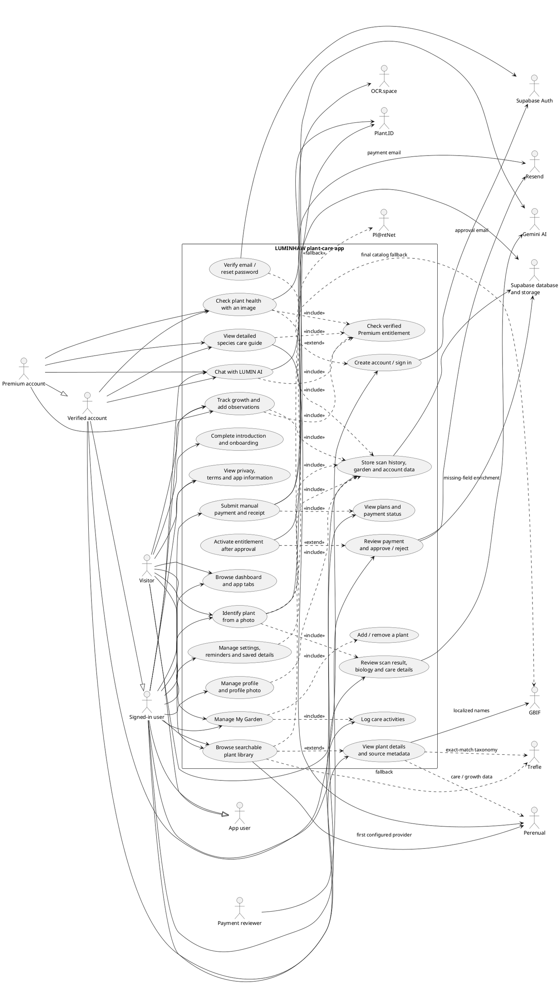

# LUMINHAW

LUMINHAW is a Flutter plant-care app for identifying plants, learning about
their biology and care, maintaining a garden journal, and tracking growth.
Flutter provides the mobile and desktop UI; Supabase provides authentication,
owner-scoped storage, and server-side provider integrations.

> **Current state:** Live plant results require configured and deployed
> Supabase Edge Functions. Provider keys belong in Supabase secrets, never in
> the Flutter app or source control. Review the
> [implementation checklist](docs/implementation-checklist.md) for deployment
> and release requirements.

## UML use-case diagram

The diagram describes the app's user-facing features and the external services
they depend on. A dashed `include` relation means the use case invokes a shared
or required step; a dashed `extend` relation represents an optional
conditional flow.



### Actors and access notes

- **Visitor:** Can use the public app entry flow, dashboard, scanner, library,
  garden, and privacy pages. Account-dependent cloud features prompt for sign-in.
- **Signed-in user:** Can manage an account, browse features, and use
  account-scoped data.
- **Verified account:** Required by server endpoints for cloud garden sync,
  plant care, health assessment, AI chat, and other protected operations.
- **Basic account:** Verified accounts can use LUMIN AI up to 10 requests per
  UTC day, including one care suggestion per plant; the server enforces the
  limits.
- **Premium account:** Server-verified subscription is required for Premium
  features and removes the Basic plan's daily LUMIN AI prompt limit in every
  build, including debug. Testing Premium access requires an active verified
  entitlement.
- **Payment reviewer:** Reviews manually submitted receipts. Approval and plan
  activation are server-controlled; manual checkout remains disabled until its
  merchant and production configuration are approved.

## Feature guide

| Feature | What it does | Main implementation |
| --- | --- | --- |
| Introduction and onboarding | Introduces the app and saves the local onboarding-complete preference. | `lib/features/onboarding/onboarding_flow.dart` |
| Authentication | Supports sign-in, sign-up, email verification, password reset and update, logout, and account deletion. On app launch, a changed installed version/build signs out the previous session and opens the login screen. | `lib/features/authentication/auth_screens.dart`, `lib/core/services/supabase_backend.dart`, `lib/core/services/app_version_service.dart` |
| Dashboard and navigation | Five tabs: Home, Library, Scan, Garden, and Profile. Home offers plant-care content and shortcuts; the Lumin AI launcher appears on the dashboard and feature pages, not onboarding or authentication pages. | `lib/features/home/presentation/app_shell.dart`, `lib/features/ai_assistant/lumin_assistant_overlay.dart` |
| Plant identification | Captures or selects a plant photo after consent and sends it to the server for identification. Plant.ID is tried first; Pl@ntNet is the fallback when configured. | `lib/features/scanner/scanner_page.dart`, `lib/core/services/plant_identification_service.dart`, `supabase/functions/plant-identification/index.ts` |
| Scan results, Biology and Nutrients | Basic scan results show common/scientific names, family, genus/species when available, description, local names, and basic care. Advanced Biology and Nutrients sections are Premium-gated in the app; the `plant-enrich` endpoint also returns only Basic-allowed sourced fields to non-Premium accounts and excludes generated AI content. | `lib/features/scan_results/scan_result_page.dart`, `lib/core/services/plant_enrichment_service.dart`, `supabase/functions/plant-enrich/index.ts` |
| Plant library | Basic users search the live catalog and view basic information; advanced species biology and extended care details are Premium-gated. Configured search providers are Perenual, Trefle, then GBIF. Eligible GBIF photos include attribution/license/source metadata. | `lib/features/library/library_page.dart`, `lib/core/services/plant_catalog_service.dart`, `supabase/functions/plant-catalog/index.ts` |
| Plant details and saved details | Opens plant details and lets users save them. Basic details include names, family/genus/species, basic description and basic care; advanced information requires Premium. | `lib/features/library/library_page.dart`, `lib/core/services/saved_plant_details_store.dart`, `lib/features/settings/saved_plant_details_page.dart` |
| My Garden | Adds and removes tracked plants. Signed-out data stays on-device; verified signed-in data uses owner-scoped Supabase records. Existing device-only data is not automatically transferred to an account. | `lib/features/garden/garden_page.dart`, `lib/features/garden/add_garden_plant_page.dart`, `lib/core/services/local_plant_data_store.dart` |
| Care activities and growth tracker | Available on Basic. Records watering, fertilizing, pruning, repotting, growth observations, and optional measurements/photos. After a care activity is saved, LUMIN AI uses its note to suggest a next step (one suggestion per plant per UTC day on Basic; four on Premium). Basic suggestions count toward Basic's 10 daily AI requests. General reminders and cautions remain rules-based. Opt-in local notifications deliver daily watering and stage-based fertilizer reminders at 9:00 AM. | `lib/features/growth_tracker/growth_tracker_page.dart`, `lib/core/services/local_plant_data_store.dart`, `lib/core/services/plant_notification_service.dart`, `supabase/functions/assistant-chat/index.ts` |
| Detailed care guide | Premium feature. Loads provider-supplied species care data from an exact Perenual species match; missing provider fields are omitted. Basic includes only the basic care instructions shown with plant information. | `lib/features/care_guide/care_guide_page.dart`, `lib/core/services/plant_care_service.dart`, `supabase/functions/plant-care/index.ts` |
| Plant health checker | With explicit consent, uploads a photo to private account storage and requests a Plant.ID health assessment. Results are suggestions, not a medical or botanical diagnosis. The server requires verified account and Premium entitlement in production. | `lib/features/health_checker/health_checker_page.dart`, `lib/core/services/plant_health_service.dart`, `supabase/functions/plant-health/index.ts` |
| LUMIN AI | Text assistant for plant-care questions and automatic care-activity suggestions. Verified Basic accounts can send 10 requests per UTC day and get one suggestion per plant per UTC day; Premium accounts get up to four suggestions per plant per day. The server enforces these limits. Chat and suggestions do not accept images. | `lib/features/ai_assistant/assistant_page.dart`, `lib/core/services/gemini_assistant_service.dart`, `supabase/functions/assistant-chat/index.ts` |
| Notifications and settings | Opt-in local notifications remind users about due watering and stage-based fertilizer checks. The notification center also displays published app updates, maintenance notices, feature announcements, and general account notices from the `system_announcements` table. Announcements are public app-wide content; do not put private account data in this table. | `lib/features/settings/settings_page.dart`, `lib/core/services/plant_notification_service.dart`, `supabase/migrations/20261110100000_system_announcements.sql` |
| Profile and settings | Updates display name and profile photo; opens subscription, scan history, saved plant details, health, growth, notification, privacy, and account settings. Care-reminder preferences are stored locally. | `lib/features/profile/profile_page.dart`, `lib/features/profile/edit_profile_page.dart`, `lib/features/settings/settings_page.dart` |
| Scan history | Lists account-owned scan records and their results; sign-in is required for account history. | `lib/features/scanner/scan_history_page.dart`, `lib/core/services/scan_history_service.dart` |
| Subscription and payment | Displays plans and entitlement status. Manual payment/receipt review has server workflows, but checkout is disabled pending approved merchant configuration. Google Play Billing is not implemented. | `lib/features/subscription/`, `lib/core/services/plan_entitlement_store.dart`, `lib/core/services/premium_payment_service.dart`, `docs/premium-payments.md` |
| Privacy and About | In-app description of the app, data handling, external providers, subscriptions, and usage. Production release still needs a reviewed, publicly hosted privacy policy. | `lib/features/information/information_pages.dart` |

## Project map

```text
lib/
  app/                       Material app, router, theme
  core/
    constants/               Shared colors and constants
    models/                  Plant and domain models
    services/                Auth, storage, catalog and provider clients
    widgets/                 Shared headers, cards, buttons, gates and UI
  features/
    ai_assistant/            LUMIN AI chat and launcher
    authentication/          Sign-in, sign-up and recovery
    care_guide/              Species care information
    garden/                  My Garden and plant creation
    growth_tracker/          Growth observations and care logs
    health_checker/          Photo-based health assessment
    home/                    Dashboard and five-tab app shell
    information/             About, privacy and terms
    library/                 Plant search and details
    onboarding/              Entry, introduction and onboarding
    profile/                 Profile and profile editor
    scan_results/            Identification and botanical details
    scanner/                 Photo identification and history
    settings/                Settings and saved details
    subscription/            Premium and manual payment screens
supabase/
  functions/                 Authenticated Edge Functions and shared code
  migrations/                Database, storage and row-level security
test/                        Flutter unit and widget tests
integration_test/            Device integration tests
assets/                      Plant artwork, icons and fonts
docs/                        Implementation and release documentation
```

## Provider and data flow

The Flutter app calls authenticated Supabase Edge Functions; provider secrets
stay server-side. The primary app integrations are:

| Provider | Use in LUMINHAW | Supabase secret |
| --- | --- | --- |
| Plant.ID | Photo identification and health assessment. | `PLANT_ID_API_KEY` |
| Pl@ntNet | Fallback photo identification if Plant.ID is unavailable. | `PLANTNET_API_KEY` |
| Perenual | Plant catalog, detailed care, and enrichment fields when available. | `PERENUAL_API_KEY` |
| Trefle | Catalog fallback and exact-match taxonomy enrichment (family/genus). | `TREFLE_API_KEY` |
| GBIF | Catalog fallback, taxonomy matching, localized names, and license-filtered occurrence images. | Public API; no key configured by this app |
| Gemini | LUMIN AI chat and generated fallback fields when configured by the enrichment function. | `GEMINI_API_KEY` |

The catalog uses this configured fallback order: **Perenual → Trefle → GBIF**.
Plant.ID is the first identification provider and Pl@ntNet is the fallback.
Provider results can be absent, rate-limited, or unavailable; the app should
show that state rather than present generated data as provider-verified.

Supabase Auth handles account identity. Owner-scoped tables and row-level
security protect account data. Signed-out garden and journal data remains
device-local. Health photos use private storage and are submitted to external
services only after user consent. Read the in-app privacy disclosure and
provider terms before release.

## Setup and local development

Install Flutter, Android tooling for Android builds, the Supabase CLI, and
Deno for Edge Function tests. Install Dart dependencies and run the app:

```powershell
flutter pub get
flutter run
```

For a different Supabase project, provide its public URL and publishable key at
run/build time:

```powershell
flutter run `
  --dart-define=SUPABASE_URL=https://YOUR_PROJECT.supabase.co `
  --dart-define=SUPABASE_PUBLISHABLE_KEY=YOUR_PUBLIC_KEY
```

Link and migrate a Supabase project, then deploy the app-facing functions:

```powershell
supabase link --project-ref YOUR_PROJECT_REF
supabase db push
supabase functions deploy plant-identification plant-catalog plant-enrich plant-care plant-health assistant-chat
```

Configure API keys as Supabase Edge Function secrets (never as Flutter
`--dart-define` values). A safer setup is to place them in an ignored,
machine-local environment file, then load it with the Supabase CLI:

```powershell
supabase secrets set --env-file supabase/.env.local
```

Use your secrets manager to populate the local file; never commit it, paste
key values into chat, or save them in command history.
Configure Supabase Auth email delivery and allowed redirect URLs before
testing verification and password recovery. Additional account, payment, and
auxiliary catalog functions are in `supabase/functions/`; deploy them only
when their matching migration, configuration, and feature are required. Do
not deploy the separate auxiliary `plant-perenual` function over the app's
`plant-care` endpoint; their contracts differ.

For local Edge Function development, create a private local environment file
from the placeholders in
[`supabase/functions/.env.example`](supabase/functions/.env.example). Keep
local secrets out of Git.

## Tests and checks

Run Flutter analysis and tests:

```powershell
flutter analyze
flutter test
```

Run the Trefle and plant-enrichment Edge Function tests:

```powershell
deno test supabase/functions/_shared/trefle_test.ts supabase/functions/_shared/plant-enrichment_test.ts
```

Provider tests should mock HTTP calls unless you are intentionally performing
a live, authenticated, non-production integration check. Do not spend
production API quota in automated tests.

## Android release

The Android application ID is `com.luminhaw.plantcare`. Before producing a
signed release, create a protected upload keystore and local
`android/key.properties` from `android/key.properties.example`. Never commit
the keystore or signing properties. Then build:

```powershell
flutter build appbundle --release
```

Google Play publication also requires a reviewed public privacy policy,
publisher contact details, data-safety review, and completion of the
production items in the
[implementation checklist](docs/implementation-checklist.md). Google Play
Billing is not currently implemented.
